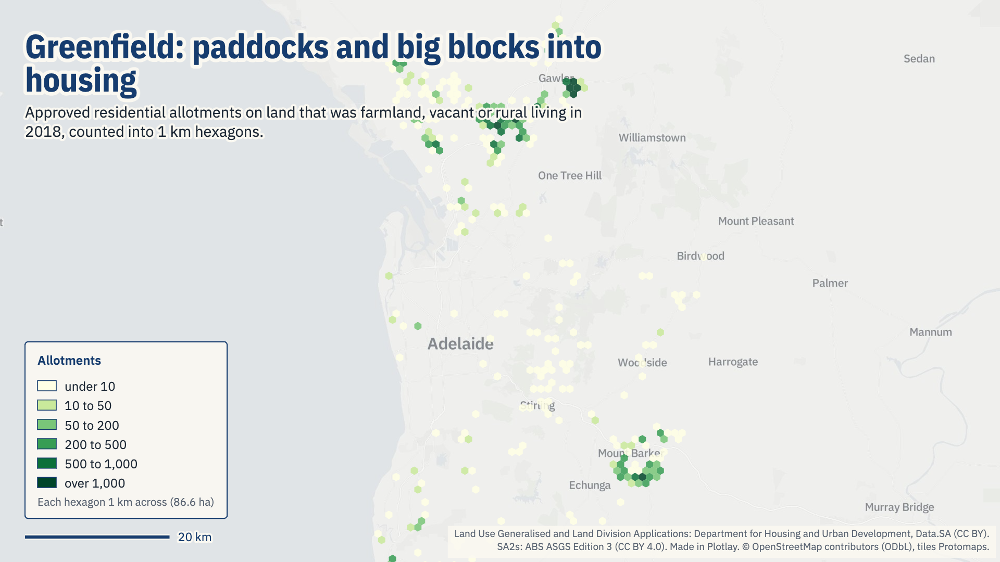
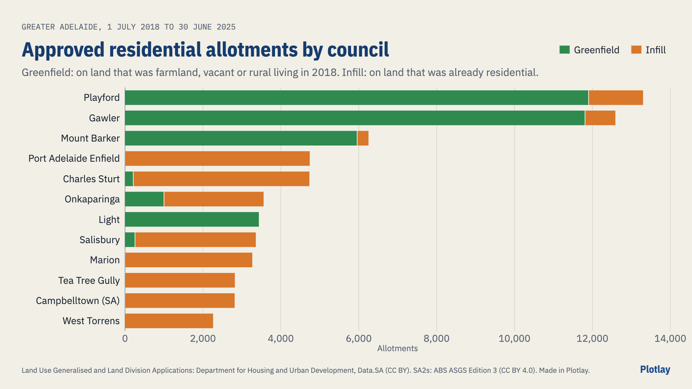

# Where is Adelaide turning paddocks and big blocks into housing?

Every residential allotment approved in Greater Adelaide in seven years, sorted by what the land was before: farmland, vacant land and rural-living blocks (greenfield), or land that was already residential (infill). From South Australia's Land Use Generalised layers for 30 June 2018 and 30 June 2025 and its Land Division Applications. **Live version, with an interactive map:** [getplotlay.com/showcase/adelaide-land-use-change](https://www.getplotlay.com/showcase/adelaide-land-use-change/)



**From 1 July 2018 to 30 June 2025, 85,145 residential allotments were approved in Greater Adelaide. 44% (37,322) were on land that was farmland, vacant land or rural living in 2018, most of them in Playford, Gawler and Mount Barker. 39% (33,607) were infill on land already residential, spread across the middle-ring councils; 69% of the 11,872 infill applications cut one block into two. About 1,101 ha of farm, vacant and rural-living land became residential land with a land division over it.**

The land use layer says what each parcel is used for each year, but it cannot count parcels: neighbouring parcels of one class are drawn as one shape, and the way they are merged changed in 2017 and 2018. So the parcels are counted from the land divisions, and the land use layer says what the land was before. [Plotlay](https://www.getplotlay.com) puts both on one map: the SA2s, hexagons, and a swipe between 2018 and 2025.

[](https://app.plotlay.io/?example=adelaide-land-use-change&as=client)

## What the data says

| Approved residential allotments, July 2018 to June 2025 | Allotments | Share |
|---|---|---|
| Greenfield: farmland, vacant land or rural living in 2018 | 37,322 | 43.8% |
| Infill: already residential in 2018 | 33,607 | 39.5% |
| Vacant urban land in 2018 (land already cut for homes) | 7,696 | 9.0% |
| Brownfield and other: industry, commerce, institutions | 6,034 | 7.1% |
| Not in the 2018 layer | 486 | 0.6% |
| **All** | **85,145** | |

- **Greenfield** is concentrated: Playford 11,909, Gawler 11,819, Mount Barker 5,970, Light 3,454.
- **Infill** is spread: Port Adelaide Enfield 4,750, Charles Sturt 4,529, Marion 3,275, Salisbury 3,110. Of 11,872 infill applications, 8,245 (69%) cut one block into two, 1,933 into three and 1,353 into four to nine.
- **The land:** 1,101 ha that were farm, vacant or rural living in 2018 are residential or vacant urban land in 2025 with a residential land division over them. Another 912 ha show the same change with no division, mostly rural-living blocks in the Hills recoded as residential; they are kept apart, not counted as building.



### Read it carefully

- **Why 2018, not 2015.** The layer's lineage says community and strata plans were handled anew from 2017, for every land use from 2018, and Greater Adelaide's classes jump between 2016 and 2018 (`data/tables/area_by_year.csv`). 2018 is the first year made the way 2025 is. Later jumps are left out of the measure: `RESERVE` drops by about 3,826 ha in 2023 and returns in 2024, and the non-private residential class (retirement villages, aged care) swings by a third between years. Only changes from farm, vacant and rural-living classes to residential ones count as greenfield.
- **The layer cannot count parcels.** Neighbouring parcels of one class are one shape, so infill is counted from the land divisions: the allotments each application's footprint became.
- **Approvals, not homes.** An approved allotment is land cut for a home; it may not be built, and one allotment can hold more than one dwelling. Apartments in one building are not land divisions.
- **Two planning laws.** Applications lodged from 19 March 2021 under the Planning, Development and Infrastructure Act 2016 record their approval in a different field and are rarely marked deposited yet, so approval under either law is read, not deposit. Counted by deposit, approvals would seem to collapse after 2021.
- **Classes come from valuation codes,** not inspection. A parcel's class can change on paper.

## How it was made with Plotlay

1. **A map project** on Plotlay's Quiet base map.
2. **Mount Barker's land: Take all** from a file of the SA2's land in pieces, each with one class in 2018 and one in 2025; the two years linked as a **time axis**; a saved view with the map **split by a swipe**, 2018 on the left, 2025 on the right.
3. **SA2s: link the summary table to an empty layer.** Plotlay reads its codes as SA2s and **makes the areas** from the official boundaries.
4. **The allotments: link the table placed by position** (latitude and longitude) on the SA2s, then **count into 1 km hexagons**, once for infill and once for greenfield.
5. **Charts, map pictures and a one-page brief** on the Analysis page.
6. **Export** GeoJSON, TopoJSON for the Power BI Shape Map and CSV with WKT.

## What's here

| Folder | What |
|---|---|
| [`data/tables/`](data/tables) | The allotments, applications, summaries by SA2, council and year, the land use transitions and the area by year |
| [`data/geometry/`](data/geometry) | Greenfield pieces, SA2s, Mount Barker's land in pieces, the hexagons |
| [`python/`](python) | A narrated notebook that recomputes every number here: [`adelaide_land_use.ipynb`](python/adelaide_land_use.ipynb); `download.py` fetches the state-wide source layers |
| [`powerbi/`](powerbi) | A Power BI Project (`.pbip`). Start with [`powerbi/OPEN-ME.md`](powerbi/OPEN-ME.md) |
| [`visuals/`](visuals) | The map pictures and charts, made in Plotlay |

### Run the notebook

```
python -m venv .venv && . .venv/bin/activate
pip install -r python/requirements.txt
jupyter notebook python/adelaide_land_use.ipynb
```

## Sources and licences

- **Land Use Generalised** (2015 to 2025) and **Land Division Applications**, Department for Housing and Urban Development: [Data.SA](https://data.sa.gov.au/data/dataset/land-use-generalised), CC BY 4.0 on the catalogue, CC BY 3.0 AU on the files.
- **ABS ASGS Edition 3** (SA2, Local Government Areas, Greater Capital City Statistical Areas, 2021): Australian Bureau of Statistics, CC BY 4.0.
- Base map in the app: Plotlay Quiet, from OpenStreetMap data (ODbL). No data here comes from OpenStreetMap.

Our tables, shapes and visuals are CC BY 4.0 ([LICENSE-DATA](LICENSE-DATA)); the code is MIT ([LICENSE](LICENSE)). Full credits in [NOTICE](NOTICE). This is independent work using open data, not endorsed by the Department for Housing and Urban Development or the ABS.
